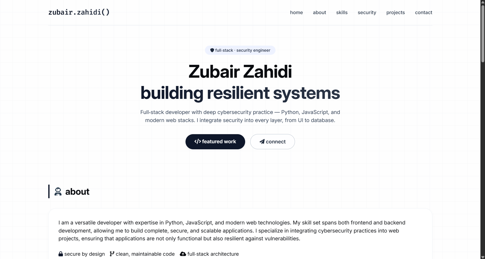
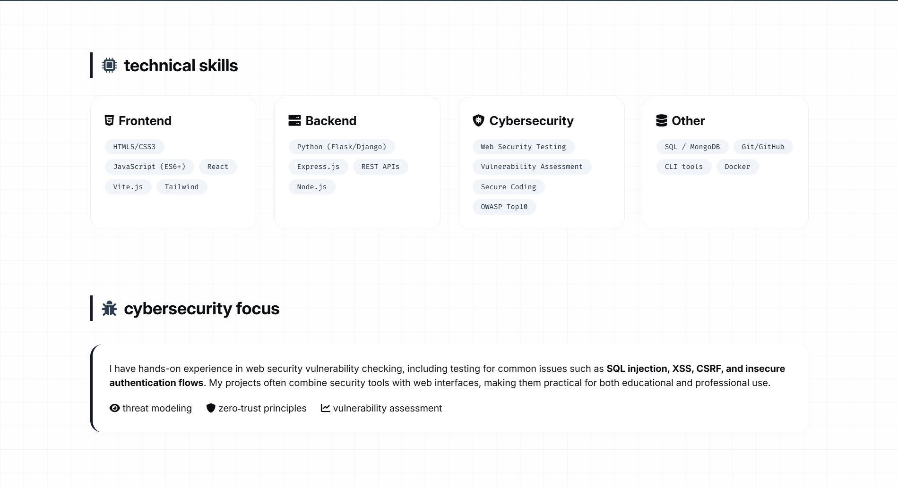

# Zubair Zahidi — Portfolio

A personal portfolio website presenting projects and development interests. Built with HTML, CSS, and JavaScript, it explores how layout, typography, and interaction can communicate a developer's work.



## View locally

Clone the repository and open `portfolio.html` in a browser. For a local server, run:

```bash
python -m http.server 8000
```

Then open `http://localhost:8000/portfolio.html`.

## Files

- `portfolio.html` — Page content and structure.
- `style.css` — Appearance and layout.
- `script.js` — Browser interactions.



Explore [Zubair's current GitHub profile](https://github.com/Zubair-zahidi) for recent projects and releases.
